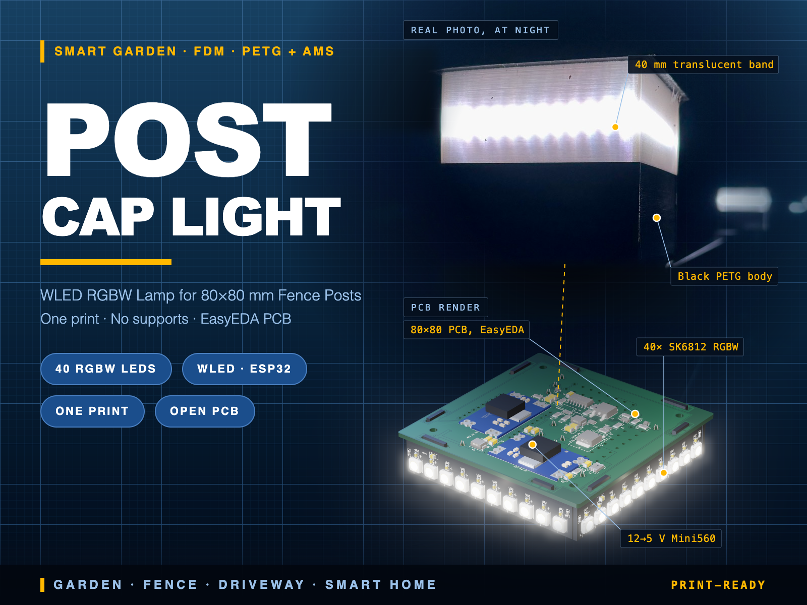
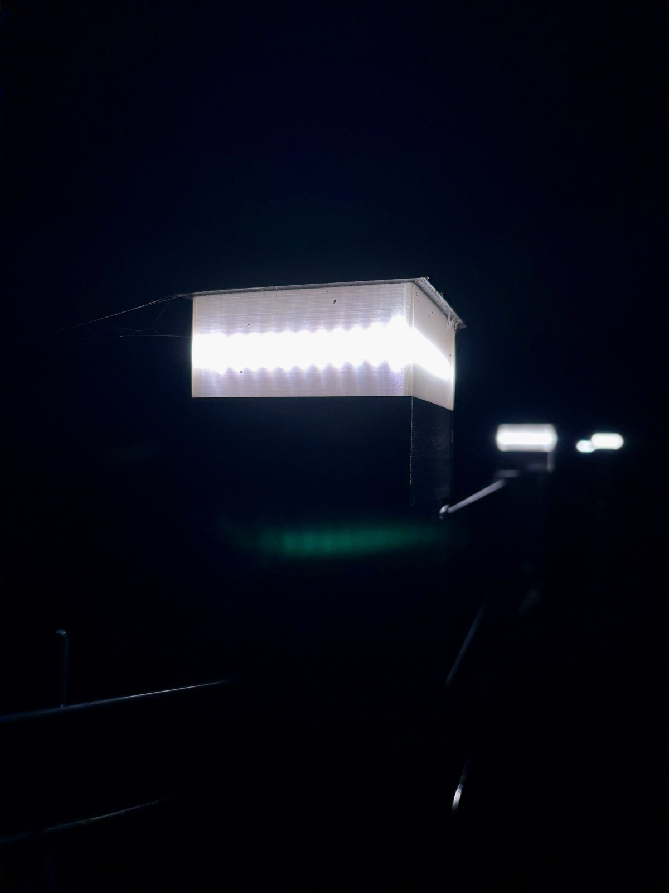
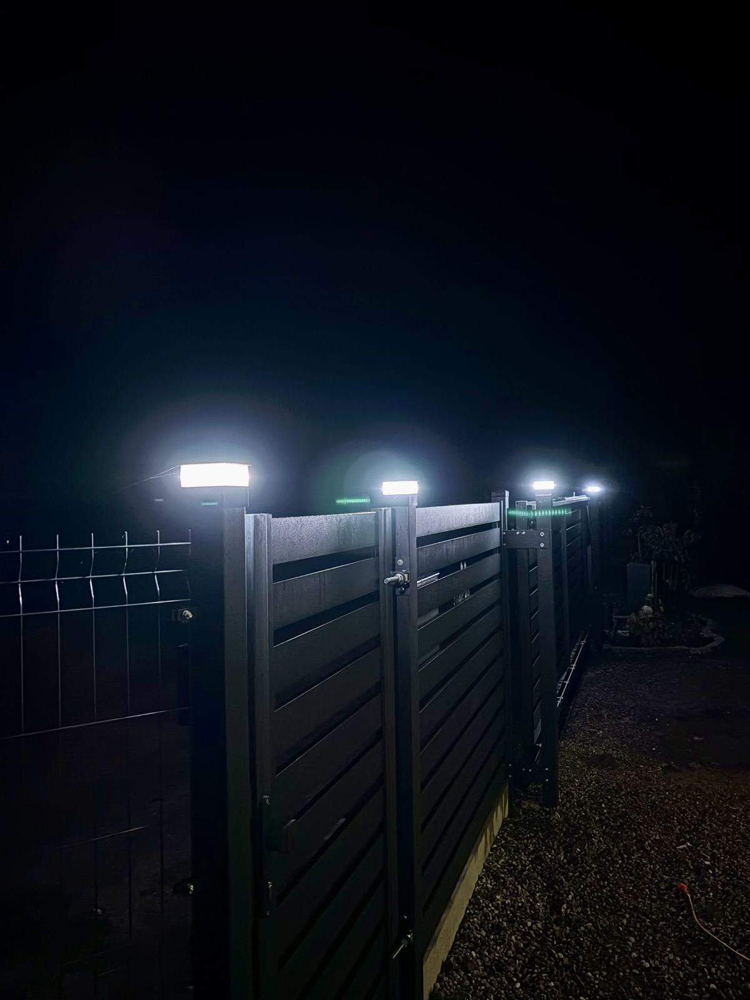
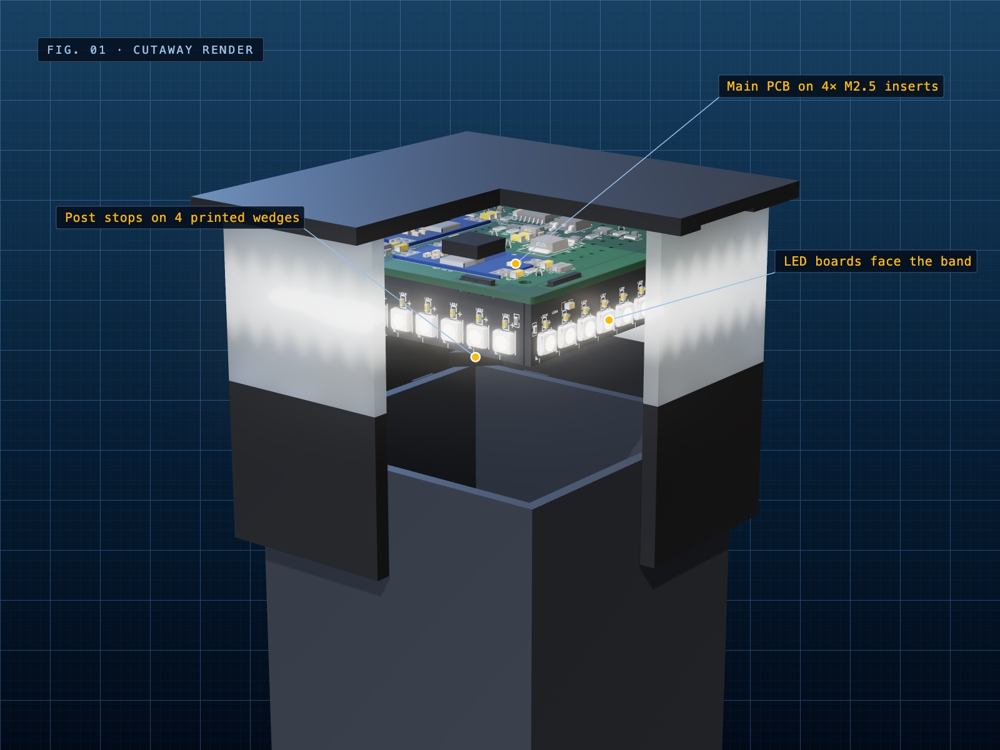
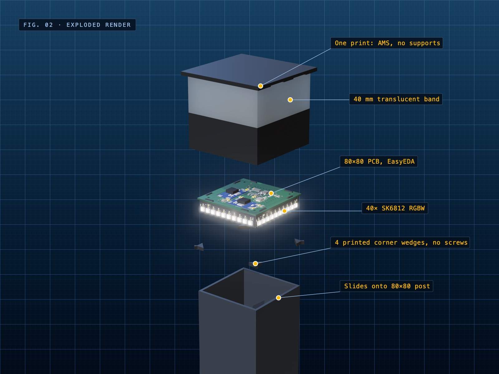
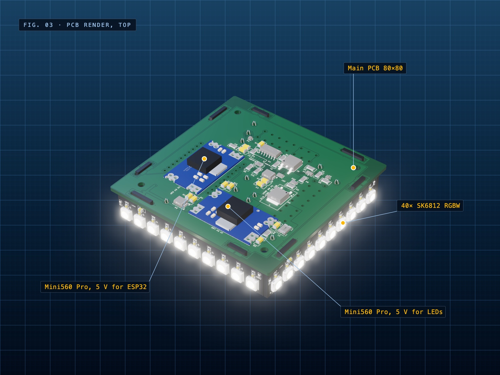
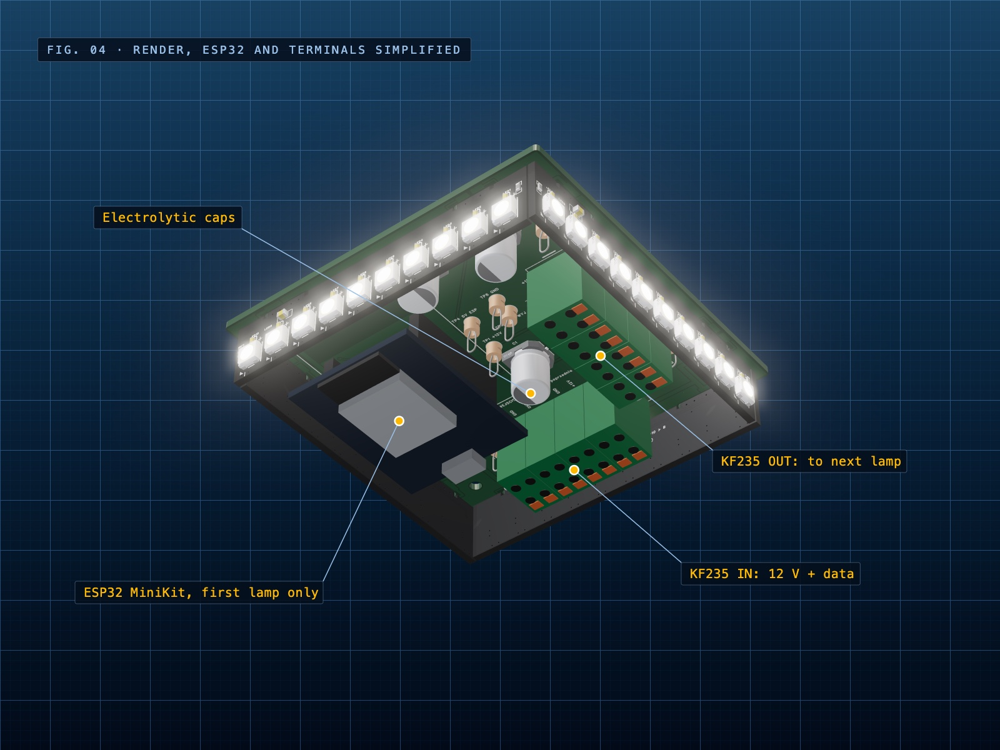
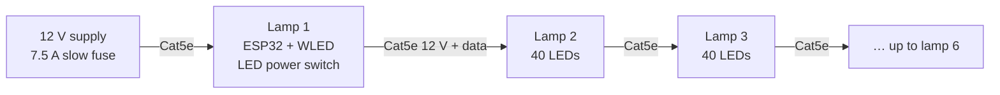
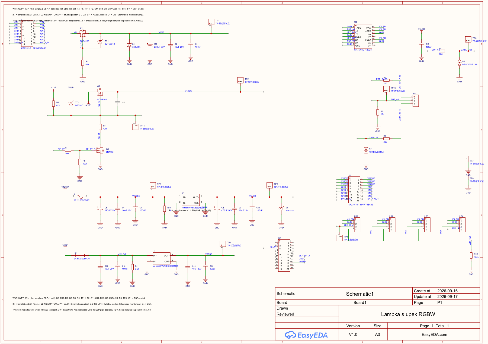

<div align="center">

# WLED Fence Post Cap Light

**A 3D-printed, daisy-chained RGBW lamp for square 80×80 mm fence posts.**<br>
One-print PETG housing, custom EasyEDA PCBs, 40 addressable LEDs per lamp, 12 V and data over a single Cat5e cable.

[](LICENSE)
[](#project-status)
[](https://kno.wled.ge/)
[](pcb/)
[](enclosure/)



</div>

## Why

This lamp runs [WLED](https://kno.wled.ge/), so a whole fence behaves as one addressable strip. The first lamp holds the ESP32. Every other lamp is just another segment on the same Cat5e run.

The electronics live on PCBs instead of LED strips glued inside a housing, because strip solder pads tear off over time outdoors.

## Highlights

- **One print, no supports.** Printed upside down on the roof, with AMS switching colour only twice: black base, translucent band, black roof.
- **Nothing visible from outside.** No screws on the housing. The post stops on four printed wedges hidden inside.
- **Even light.** The 4 mm band wall is printed entirely as perimeters, so no infill pattern shows through.
- **Fits your post without tools.** Eight centering ribs with a lead-in chamfer, vent grooves under the roof for moisture.
- **Chainable.** 12 V, GND and data on Cat5e. Each lamp has its own 12→5 V converter, so cable voltage drop does not change LED brightness.
- **Protected inputs.** Reverse polarity MOSFET, TVS diodes, PTC fuses, and ESD protection on the data lines.

## Gallery

| Real lamps at night | Row on the fence |
|:---:|:---:|
|  |  |

| Cutaway | Exploded view |
|:---:|:---:|
|  |  |

| PCB, roof side | PCB, post side |
|:---:|:---:|
|  |  |

> The night photos show an earlier version of these lamps with LED strips, in the same form factor. Photos of the PCB version will replace them after bring-up. All other images are renders of the actual CAD and PCB data; the ESP32 module and terminal blocks are simplified.

## Specifications

| | |
|---|---|
| **Fits** | Square 80×80 mm posts, slides on from above |
| **Size** | 90 × 90 × 83 mm, roof 100 × 100 mm |
| **LEDs** | 40 × SKC6812RGBW-WS-B (5050), 10 per side, 7.14 mm pitch |
| **Controller** | ESP32 D1 Mini running WLED, first lamp in the chain only |
| **Supply** | 12 V over Cat5e, 5 V from a local Mini560 Pro in each lamp |
| **LED power** | Up to 8.1 W per lamp at full RGBW |
| **Designed chain** | 6 lamps, 5 m between lamps, WLED current limiter required |
| **Housing** | PETG black + PETG translucent, about 6 h and 170 g on a Bambu Lab P1S with AMS |

## How it fits together



Each lamp contains one main board (80×80 mm) and four LED boards soldered into its slots in a pinwheel, facing the translucent band. Data enters the board, goes through a 5 V level shifter, around all four LED boards, and back out to the next lamp through the same buffer, so the signal is regenerated at every lamp.

<a href="docs/schematic_main.pdf"></a>

Schematics: [main board](docs/schematic_main.pdf) · [LED board](docs/schematic_led.pdf)

## Build it

| Step | What to do | Where |
|---|---|---|
| 1 | Print the housing and 4 wedges | [`enclosure/`](enclosure/) |
| 2 | Order the PCBs (Gerber, BOM, positions) | [`pcb/`](pcb/) |
| 3 | Solder the main board, choose the variant, fit the LED boards | [Assembly guide](docs/assembly.md) |
| 4 | Test each lamp, then the chain, and configure WLED | [Bring-up guide](docs/bringup.md) |

### Hardware for one lamp

- 4 × M2.5 heat-set inserts (hole Ø3.3 × 5 mm) and 4 × M2.5 screws
- 1 × main PCB and 4 × LED PCBs ([BOM](pcb/manufacturing/))
- 2 × Mini560 Pro 5 V on the first lamp, 1 on the others
- 1 × ESP32 D1 Mini, first lamp only
- 2 × KF235-3.81 4×2P spring terminals
- Cat5e cable, 12 V supply, 7.5 A slow fuse at the supply

### WLED settings

| Setting | Value |
|---|---|
| LED type | SK6812 RGBW, colour order GRB |
| LED count | 40 × number of lamps |
| Data GPIO | 16 |
| Relay GPIO | 26, active high |
| Current limiter (ABL) | **Required.** LED current 40 mA, max current 3600 mA to start with |

Do not connect USB to the ESP32 while the board is powered from 12 V.

## Repository layout

```
├── enclosure/              Parametric FreeCAD model and print files
│   ├── build.py            Generates the housing, wedges and fit checks
│   ├── druk*.py            Bambu Studio project generators
│   ├── exports/            STL (colour zones + wedges) and STEP
│   └── makerworld/         Ready-to-print 3MF
├── pcb/
│   ├── easyeda/            EasyEDA Pro project (.epro2)
│   ├── gerber/             Gerbers: main board and LED panel
│   ├── manufacturing/      BOM and pick-and-place files
│   └── step/               3D model of the assembled electronics
├── calc/                   Voltage drop, thermal and SPICE calculations
└── docs/
    ├── assembly.md         Assembly guide
    ├── bringup.md          Test and configuration procedure
    ├── schematic_*.pdf     Schematics
    └── pl/                 Detailed engineering notes (in Polish)
```

## Project status

- [x] Schematic and PCB design, DRC clean, netlists verified
- [x] Electrical review and simulation: 24 checks, 19 pass, 5 warnings, 0 fail ([results, in Polish](docs/pl/testy.md))
- [x] PCBs fabricated
- [ ] Hardware bring-up ([procedure](docs/bringup.md))
- [ ] Test print of this housing revision with the real boards
- [ ] Replace the night photos with the PCB version

**This hardware has not been verified in operation yet.** The checks above are design reviews and simulations. Things still to confirm on real hardware: the KF235 terminal footprint, the ESP32 module pinout, the post fit, and LED temperature behind the PETG band. Build one lamp first.

Known requirements from the design review:

- The WLED current limiter is mandatory. Without it, the last of 6 lamps drops to about 7 V at full brightness, below the converter's 8 V minimum.
- Wait at least 0.5 s between switching the LED power off and on, because of the converter's undervoltage latch.
- Exclude J1 from the LED board BOM. It is only the board's tab pads.

## Regenerating the files

```bash
cd enclosure
/Applications/FreeCAD.app/Contents/Resources/bin/freecadcmd build.py   # model, STL, STEP and fit report
python3 druk.py                                                        # Bambu Studio project with your own presets
python3 druk_makerworld.py                                             # 3MF with stock presets for MakerWorld
```

All dimensions are parameters at the top of `build.py`. Paths in the `druk` scripts assume Bambu Studio on macOS. Code comments are in Polish.

## License

[CC BY-NC-SA 4.0](LICENSE): free to build, modify and share for non-commercial use, with attribution, under the same license.

WLED, Bambu Lab, EasyEDA and JLCPCB are trademarks of their owners. This project is not affiliated with them. You build and install this at your own risk.

---

<details>
<summary><b>Po polsku</b></summary>

Lampka na słupek ogrodzeniowy 80×80 mm: drukowana obudowa PETG (jeden wydruk, bez podpór), własne płytki z EasyEDA, 40 diod RGBW na lampkę, sterowanie WLED, zasilanie 12 V i dane po jednym kablu Cat5e. Pierwsza lampka ma ESP32, kolejne to następne segmenty tego samego łańcucha.

Szczegółowe notatki projektowe są w [`docs/pl/`](docs/pl/). Płytki są wyprodukowane, ale elektronika nie została jeszcze uruchomiona na sprzęcie, więc zacznij od jednej lampki.

</details>
